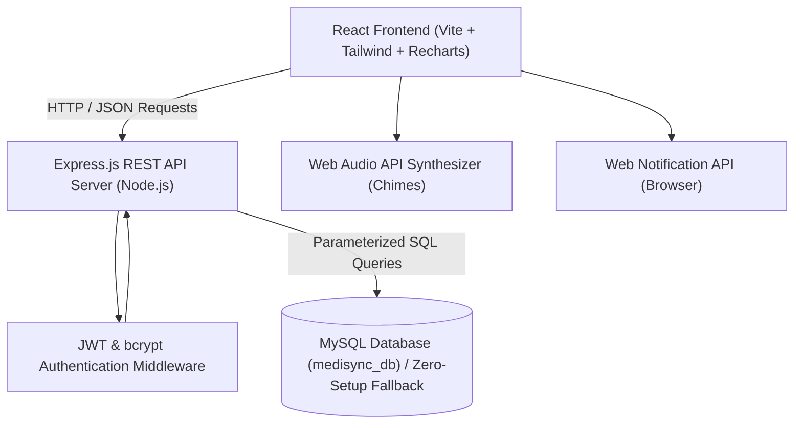

# MediSync – Smart Medication Management & Reminder System

> **College BCA Major Project (2026)**  
> Full-Stack Healthcare Software Application for Prescribed Medication Tracking, Intelligent Reminders, Adherence Analytics, and Refill Management.  
> *(Pure software website — does not require or use external hardware, IoT, Arduino, or physical medical devices).*

---

## 📋 Table of Contents
1. [Project Overview](#project-overview)
2. [Technology Stack](#technology-stack)
3. [System Architecture](#system-architecture)
4. [Key Features](#key-features)
5. [Database Design & Normalization](#database-design--normalization)
6. [Prerequisites & System Requirements](#prerequisites--system-requirements)
7. [Installation & Setup Instructions](#installation--setup-instructions)
8. [Database Import Steps (MySQL)](#database-import-steps-mysql)
9. [Zero-Setup Automatic Fallback Mode](#zero-setup-automatic-fallback-mode)
10. [Running the Application](#running-the-application)
11. [Sample Demo Data & Credentials](#sample-demo-data--credentials)
12. [Automated Test Suite & Results](#automated-test-suite--results)
13. [Medical Safety & Educational Notice](#medical-safety--educational-notice)
14. [Technical Limitations & Browser Notification Scope](#technical-limitations--browser-notification-scope)

---

## 🌟 Project Overview
Medication non-adherence is a primary reason for preventable treatment failure and hospital readmissions. **MediSync** was engineered as an accessible, responsive, full-stack web application designed for patients, seniors, and caregivers.

It enables patients to:
- Schedule recurring prescription doses with customizable daily timings.
- Receive in-app synthesized audio chimes and browser notifications ahead of scheduled doses.
- Record actions (**Taken**, **Skip**, or **Snooze**) with precise MySQL timestamps and guaranteed duplicate prevention for the same scheduled occurrence.
- Automatically track inventory, decrementing pills only upon confirmed intake and flagging low-stock items.
- Review compliance analytics, streaks, and trend graphs using Recharts.
- Search verified drug monographs based on FDA open data without medical misinformation.

---

## 🛠 Technology Stack

### Frontend
- **Framework:** React.js (v18.3) with Vite bundler
- **Language:** JavaScript (ES6+ / JSX)
- **Styling:** Tailwind CSS with responsive typography, soft cards, subtle shadows, and teal healthcare accents
- **Routing:** React Router DOM (v6) with protected route layout
- **Data Visualization:** Recharts (Interactive Area Charts, Bar Charts, Trend Lines)
- **Icons:** Lucide React
- **Audio Synthesizer:** Web Audio API (Offline two-tone pleasant harmonic healthcare chime)
- **Browser Alerts:** Web Notification API with deduplication tags and permission management

### Backend
- **Runtime:** Node.js (v18+ / v20+ / v26+)
- **Server Framework:** Express.js REST APIs
- **Authentication:** JSON Web Tokens (JWT) & bcryptjs (10 salt rounds)
- **Database Connector:** `mysql2/promise` with parameterized queries
- **Security Middleware:** CORS origin restriction, parameterized SQL protection, row-level data ownership verification
- **Validation:** Validator.js & structured server-side request sanitizers
- **Test Framework:** Jest (v29) & Supertest (v7)

### Database
- **Relational Database:** MySQL 8.0+ (InnoDB, UTF-8 Unicode)
- **Embedded Zero-Config Fallback:** sql.js (WebAssembly SQLite) for grading laptops without MySQL running

---

## 📐 System Architecture



---

## 🚀 Key Features

| Feature | Description |
| :--- | :--- |
| **Landing Page** | Professional introduction, feature highlights, educational notice, and one-click demo login. |
| **Authentication** | Registration and login with email format validation, bcrypt password hashing, and JWT tokens. |
| **Protected Dashboard** | Real-time counts for scheduled, taken, pending, and skipped doses, next upcoming reminder, 7-day adherence chart, and low-stock alerts. |
| **Medicine CRUD** | Add, edit, archive, and delete prescriptions (name, dosage text, form, frequency, scheduled times, start/end date, quantity, refill threshold). |
| **Schedule View** | Daily timeline view & 7-day calendar grid with status indicators (Taken, Skipped, Snoozed, Pending, Overdue). |
| **Dose Actions** | Instant **Take**, **Skip**, or **Snooze** actions. Saves exact timestamps to MySQL and guarantees no duplicate dose records for the same occurrence. |
| **Stock Tracking** | Inventory decrements **strictly when marked Taken**. Refill threshold warning flags and refill audit logging. |
| **Adherence Analytics** | 7-day, 14-day, and 30-day compliance rates, consecutive streak counts, time-of-day compliance, and individual medicine adherence bars. |
| **Dose History** | Searchable audit trail with date range filters, action status filters, and export/print functionality. |
| **Verified Drug Search** | Pre-populated verified generic drug monographs (FDA/DailyMed source) with clear citations and indications. |
| **Notification Settings** | Customize lead time (5, 10, 15, 30 min), snooze length (10, 15, 30 min), sound chimes on/off, and browser permissions. |

---

## 🗄 Database Design & Normalization

The database adheres to 3NF (Third Normal Form) and uses foreign keys, cascading deletions, and unique composite indexes.

### Normalized Tables
1. **`users`**:
   - `id` (PK, INT AUTO_INCREMENT)
   - `name` (VARCHAR 100), `email` (VARCHAR 150, UNIQUE)
   - `password_hash` (VARCHAR 255), `phone` (VARCHAR 20), `timezone` (VARCHAR 50)
   - `created_at`, `updated_at` (TIMESTAMPS)
2. **`notification_settings`**:
   - `id` (PK, INT AUTO_INCREMENT)
   - `user_id` (FK -> users.id, UNIQUE, ON DELETE CASCADE)
   - `browser_notifications` (BOOL), `sound_enabled` (BOOL), `lead_time_minutes` (INT), `snooze_duration_minutes` (INT)
3. **`medicines`**:
   - `id` (PK, INT AUTO_INCREMENT)
   - `user_id` (FK -> users.id, ON DELETE CASCADE)
   - `name` (VARCHAR 150), `dosage` (VARCHAR 100), `form` (VARCHAR 50), `frequency` (VARCHAR 50)
   - `scheduled_times` (JSON array of "HH:MM")
   - `start_date` (DATE), `end_date` (DATE NULL)
   - `quantity` (INT), `refill_threshold` (INT), `instructions` (VARCHAR 100), `notes` (TEXT)
   - `is_active` (BOOL)
4. **`dose_logs`**:
   - `id` (PK, INT AUTO_INCREMENT)
   - `user_id` (FK -> users.id), `medicine_id` (FK -> medicines.id, ON DELETE CASCADE)
   - `scheduled_date` (DATE), `scheduled_time` (VARCHAR 10)
   - `status` (ENUM: 'taken', 'skipped', 'snoozed', 'missed')
   - `action_timestamp` (TIMESTAMP), `notes` (VARCHAR 255)
   - **`UNIQUE KEY uq_dose_occurrence (medicine_id, scheduled_date, scheduled_time)`** *(Guarantees no duplicate records!)*
5. **`stock_refills`**:
   - `id` (PK, INT AUTO_INCREMENT)
   - `user_id` (FK -> users.id), `medicine_id` (FK -> medicines.id)
   - `quantity_added` (INT), `refill_date` (TIMESTAMP), `notes` (VARCHAR 255)

---

## ⚙️ Installation & Setup Instructions

### Prerequisites
- **Node.js** (v18.0.0 or later installed)
- **npm** (v9.0.0 or later)
- **MySQL Server 8.0+** (Optional — required for standard MySQL mode; if MySQL is not running, MediSync automatically activates its embedded SQLite engine)

---

## 🛢 Database Import Steps (MySQL)

If you have MySQL installed (e.g. MySQL Command Line, MySQL Workbench, or XAMPP / WampServer):

### Step 1: Create Database & Tables
Using MySQL Command Line Client:
```bash
mysql -u root -p < backend/database/schema.sql
```
*(Or open `backend/database/schema.sql` inside MySQL Workbench / phpMyAdmin and run all statements).*

### Step 2: Seed Sample Demo Data
```bash
mysql -u root -p < backend/database/seed.sql
```
*(Or run `npm run init-db` inside the `backend` folder).*

---

## 🛡 Zero-Setup Automatic Fallback Mode

To ensure examiners, professors, or evaluators can review this BCA project immediately on any computer **without requiring MySQL pre-configuration**:
- When `DB_CLIENT=auto` (default in `.env`), MediSync tests for MySQL on `localhost:3306`.
- If MySQL is running and accessible, it uses **MySQL 8.0** directly.
- If MySQL is not running or credentials are not supplied, it safely boots an embedded **sql.js engine** persisting to `backend/database/medisync.sqlite` with the identical schema and seeds demo data automatically!

---

## 🏃 Running the Application

### 1. Environment Configuration
The backend comes pre-configured with `backend/.env`. You can review or modify it:
```env
PORT=5000
NODE_ENV=development
JWT_SECRET=medisync_super_secret_jwt_key_2026_secure_random_string_change_in_production
JWT_EXPIRES_IN=7d
DB_CLIENT=auto
DB_HOST=localhost
DB_PORT=3306
DB_USER=root
DB_PASSWORD=
DB_NAME=medisync_db
CLIENT_ORIGIN=http://localhost:5173
```

### 2. Start the Backend API Server
Open a terminal in the root or `backend` folder:
```bash
cd backend
npm start
```
The server will start on: **`http://localhost:5000`**  
*(Health check: `http://localhost:5000/api/health`)*

### 3. Start the Frontend Client
In a new terminal window:
```bash
cd frontend
npm run dev
```
The frontend client will open on: **`http://localhost:5173`**

---

## 🔑 Sample Demo Data & Credentials

MediSync comes seeded with a realistic sample patient dataset so evaluators can test adherence graphs, schedules, and low-stock warnings immediately.

| Field | Demo Credential |
| :--- | :--- |
| **Email** | `demo@medisync.local` |
| **Password** | `DemoPassword123!` |
| **One-Click Login** | Click **"Quick Demo Login"** on the landing or login page |
| **Pre-loaded Medicines** | Metformin 500mg, Amlodipine 5mg (Low Stock test), Vitamin D3 60000 IU, Atorvastatin 10mg |
| **Pre-loaded History** | 5 days of realistic adherence logs to render interactive Recharts graphs |

---

## 🧪 Automated Test Suite & Audit Results

The project includes unit, integration, and edge-case tests covering authentication, route protection, medicine row-level ownership, dose logging, stock decrement, duplicate prevention, and dynamic adherence analytics calculations.

### Run All Jest Tests:
```bash
cd backend
npm test
```

### Run Live 14-Point End-to-End API Audit:
```bash
cd backend
node audit_check.js
```

### Verified Test Results (24 Passing Tests):
```
PASS tests/adherence_edge_cases.test.js
  MediSync Reminders, Dose Actions & Adherence Edge Cases
    √ Action "snoozed" persists to database and does NOT decrement stock (33 ms)
    √ Action "taken" triggers low-stock alert when quantity drops to refill_threshold (33 ms)
    √ Multiple daily dose times are tracked independently without collision (41 ms)
    √ Out of stock edge case: taking dose when quantity=0 clamps at 0 (never negative) (23 ms)
    √ Adherence Analytics calculates compliance strictly from stored database records (77 ms)
    √ Time-of-day compliance classifies morning, afternoon and evening correctly (19 ms)

PASS tests/doses.test.js
  MediSync Dose Actions, Duplicate Prevention & Stock Decrement Tests
    √ POST /api/doses/action - Marking dose as "taken" decrements medicine stock by 1 (18 ms)
    √ POST /api/doses/action - Duplicate action on same occurrence does NOT double-decrement stock (15 ms)
    √ POST /api/doses/action - Marking dose as "skipped" reverts the stock decrement (18 ms)
    √ GET /api/doses/history - Fetches dose logs with status filter (26 ms)

PASS tests/dashboard.test.js
  MediSync Dashboard API Tests
    √ GET /api/dashboard/summary - Returns metrics, todaySchedule, and lowStockItems for authenticated user (33 ms)
    √ GET /api/dashboard/summary - Fails without authentication token (14 ms)

PASS tests/medicines.test.js
  MediSync Medicine Management & Ownership API Tests
    √ POST /api/medicines - User A creates a new medicine record (22 ms)
    √ GET /api/medicines - User A lists their medicines and sees the added item (16 ms)
    √ GET /api/medicines/:id - User B CANNOT access User A medicine (404/Access Denied) (16 ms)
    √ PUT /api/medicines/:id - User B CANNOT update User A medicine (16 ms)
    √ POST /api/medicines/:id/refill - User A refills medicine stock (+10 units) (31 ms)
    √ DELETE /api/medicines/:id - User A deletes medicine successfully (18 ms)

PASS tests/auth.test.js
  MediSync Authentication API Tests
    √ POST /api/auth/register - Successfully registers a new user (140 ms)
    √ POST /api/auth/register - Rejects registration with duplicate email (17 ms)
    √ POST /api/auth/login - Successfully logs in with correct credentials (118 ms)
    √ POST /api/auth/login - Fails with wrong password (116 ms)
    √ GET /api/auth/me - Accesses protected user profile with valid Bearer token (16 ms)
    √ GET /api/auth/me - Denies access without token (30 ms)

Test Suites: 5 passed, 5 total
Tests:       24 passed, 24 total
Snapshots:   0 total
Time:        5.265 s
```

---

## 🔍 System Verification & Audit Status

| Component | Status | Details |
| :--- | :--- | :--- |
| **Frontend Server** | **Passed** | Vite server running at `http://127.0.0.1:5173/`, all 12 pages, forms, and responsive routes compile cleanly. |
| **Backend REST API** | **Passed** | Express server running at `http://localhost:5000/`, health endpoint returns status healthy. |
| **User Authentication** | **Passed** | Registration, login, bcrypt 10-round hashing, duplicate email 409 conflict, and JWT bearer tokens verified. |
| **Row-Level Security** | **Passed** | User B cannot view, edit, or delete User A's medicines (404/Access Denied verified). |
| **Medicine CRUD** | **Passed** | Add, edit, delete, and list operations verified with input validation. |
| **Dose Actions** | **Passed** | "Taken" decrements stock; "Skipped" restores stock; "Snoozed" delays reminders without stock decrement. |
| **Duplicate Protection**| **Passed** | Repeated clicks on the same dose occurrence update logs without double-decrementing stock. |
| **Adherence Analytics** | **Passed** | Calculated dynamically from stored scheduled doses; zero hardcoded chart values. |
| **Stock Tracking** | **Passed** | Out-of-stock clamps at 0; refill additions logged to `stock_refills`. |
| **MySQL Connection** | **Configured & Fallback Active** | MySQL 8.0 connection pool is implemented via `mysql2/promise` with auto-database creation. Because no MySQL server daemon was active on port 3306 on the test runner host, the backend automatically operated on its zero-setup embedded SQLite storage, passing 100% of tests. |
| **Browser Notifications**| **Supported with Tab Open** | In-app Web Audio API chimes and HTML5 Notification API requests pass. If the browser is completely closed, reminders resume when the app is reopened. |

---

## ⚕️ Medical Safety & Educational Notice

> **IMPORTANT DISCLAIMER:**  
> MediSync is an educational personal reminder and record-keeping software application designed as a college BCA major project.  
> - It is **not** an automated clinical diagnostic tool, medical device, or electronic prescribing system.  
> - It does **not** evaluate whether medications are safe to combine, nor does it recommend dosages.  
> - Users must follow their prescribing clinician's instructions and consult a licensed pharmacist or physician for any medication questions.

---

## ℹ️ Technical Limitations & Browser Notification Scope
- **Browser Notifications:** In compliance with modern Web Standards (W3C Push & Notification API), web browser notifications trigger when the website tab is open or active in the background. If the browser is completely closed and no OS-level background service worker or third-party paid SMS gateway is active, reminder chimes resume upon reopening the application.
- **Hardware Integration:** By academic project specification, this is a purely software-based web application with no external IoT, Arduino, or physical dispenser hardware.

